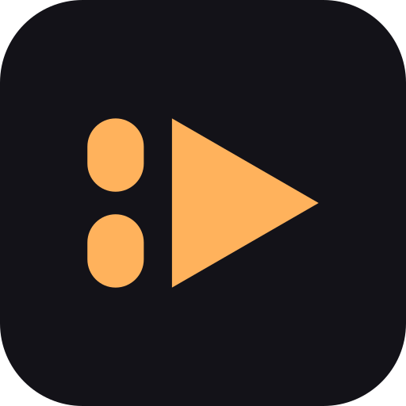

<p align="center">
  
</p>

<h1 align="center">Free Social</h1>

<p align="center"><strong>Scroll past. Watch on purpose.</strong></p>

<p align="center">
  An Android app that takes the infinite reel out of Instagram, YouTube and TikTok —
  while the apps themselves stay fully usable.
</p>

<p align="center">
  <a href="https://github.com/K3vinb5/free-social/actions/workflows/release.yml"></a>
  <a href="https://github.com/K3vinb5/free-social/releases"></a>
  
  
</p>

---

## What it is

Free Social is not a replacement client, a VPN, a DNS filter or a webview. It is an
[AccessibilityService](https://developer.android.com/guide/topics/ui/accessibility/service)
that reads the **real** Instagram, YouTube and TikTok node trees and acts on the
short-video surfaces inside them: reel cells in the feed, the Reels tab, the Shorts shelf,
the Shorts player, TikTok playback.

Everything else in those apps keeps working — DMs, search, stories, comments, profiles,
long-form video. Reel cells in the Instagram feed, the Reels tab and the YouTube Shorts shelf
are removed outright. Opening short video on purpose is metered by a daily budget instead,
and blocked once that budget is spent. Whole-app blocking exists too, but it is opt-in per
app, never a default.

The interface ships in **English, Portuguese and Spanish**. The app has **no `INTERNET`
permission**, no accounts and no telemetry. It cannot phone home, because it was never given
the ability to.

## Features

| Feature | What it does |
| --- | --- |
| Filtering inside the real apps | Reads the installed Instagram, YouTube and TikTok screens through AccessibilityService and acts on the short-video surfaces there. No modified client, no proxy, no screen recording. |
| Per-app Filter / Block / Allow | Three states per app, applied to the running service immediately, never after a restart. Filter is the default for all three; Block is opt-in. |
| Short-video budget | One daily allowance shared by Instagram Reels, YouTube Shorts and TikTok playback, reset at midnight. Deliberate playback draws from it; a passive feed scroll never does. |
| Honest status | The hub pill reads `Paused · X min left` while short video still plays, `Filtering on` only when it is actually gated (budget spent or sleep window active), `Service off` when nothing runs. No cheerful lie. |
| Mandatory sleep window | A nightly window per weekday, always on, enforced with exact alarms, minimum 6 hours. No wind-down, no morning lock, no off switch. |
| Escape flash | A 2.2 s *Free Social blocked this* screen after a real escape, naming the reason. Never a dismissable wall. |
| DM carve-outs | Instagram and TikTok DMs are left alone, including a reel opened inside a DM thread: carve-out rules anchor on the message composer and force a skip. |
| Surfaces & rules | The Rule Inspector dumps the screen you are on, lists the nodes the engine reads and every rule that matches, with its anchor evidence. |
| Guided capture | Pick a surface and the app opens the target app, waits until the surface is detected, records for ~15 s and stops itself. Filtering and blocking pause for the whole flow. |
| Heal without a rebuild | After a vendor update: capture the new tree, expand the dump to see what still matches, then export, edit and re-import `rules.json`. Import is validated and hot-applied; *Use built-in rules* reverts. |
| Staleness warning | Compares each rule's verified app version with the one installed and warns before a vendor update quietly degrades filtering — with **Capture now** as the next step. |
| Bounded captures | Old dumps are pruned automatically (newest 25 per surface, 14 days) and can be deleted one by one or all at once from the inspector. |
| Five-step setup | Restricted settings, filtering service, block service, overlay, battery exemption — the wizard advances by itself as each grant lands, with a brief `✓ Granted` beat so the jump is never a mystery. |
| Localised UI | UI copy in English, Portuguese and Spanish; rules never depend on UI text, so a localised target app does not break filtering. |
| Offline by construction | No network permission, no analytics, no account, no backend. |

### Screens

<p align="center">
  
</p>

<p align="center"><em>The hub says what is actually true: short video still plays while the
budget lasts, so the pill says <code>Paused · 20 min left</code> — not “Filtering on”.</em></p>

<p align="center">
  
  
  
  
</p>

## Install

1. Download from **[freesocial.k3vinb5.dev](https://freesocial.k3vinb5.dev/)** — stable
   builds and nightlies in one place — or from
   [Releases](https://github.com/K3vinb5/free-social/releases). The zip next to each APK is
   the same signed build plus a short install note.
2. Tap the APK and allow install from this source when Android asks.
3. Follow the five-step wizard: restricted settings → filtering service → optional block
   service → overlay → battery exemption. Rules are verified for the Instagram, YouTube and
   TikTok versions shown on the hub; an app update raises a staleness warning instead of
   failing silently.
4. On Android 13+ the APK is sideloaded, so Android hides the accessibility toggle behind
   *App info → ⋮ → Allow restricted settings*. The wizard walks through it; without that step
   the service switch is dead.

## How the engine works

The service receives accessibility events, rebuilds a bounded snapshot of the relevant
window's node tree, and asks a small ordered rule catalog whether any **anchor** matches.
Anchors are view IDs, structural relationships, classes and `selected` state — **not UI
strings** — so rules survive a German or Japanese phone. Loader tests enforce the
language-independence rule; a text-anchored rule that cannot be proven locale-proof does not
ship.

Rules come in two layers. **Layer 1** is always on: reel cells in the feed, the Reels tab and
the Shorts shelf are removed the moment one appears. **Layer 2** is budget-governed: opening
a reel, a Short or TikTok playback deliberately is allowed while the daily allowance lasts and
met with one escape once it is spent or the sleep window is locked.

Matching is gated by policy, not by a blunt "is this app open" check:

- **DIRECT-ENGAGEMENT** — a passive feed scroll is not engagement. Only a deliberate entry
  into a short-video surface starts the budget clock.
- **One action per scan** — the most escape-like action wins: home tab, back, click a view,
  redirect home. Exactly one runs per scan, and every escape flashes once confirmed.
- **Budget** — shared daily minutes, midnight reset, locked hours counted as spent.
- **Carve-outs win** — a matched skip rule (a DM composer, a reply box) shields the whole
  scan, whatever else matched.
- **Fail-open, but loudly** — if a vendor update changes the tree, rules stop matching. The
  app does not pretend otherwise: it warns on version staleness, and the inspector shows
  what no longer matches.

### Why anchors, not text

Localised builds change every visible string but rarely change resource IDs or the shape of
the view hierarchy. A rule such as "the Reels tab is the `clips_tab` whose `selected` state
flipped" keeps working in any language; a rule that looks for the word "Reels" does not.
Text is used only where a vendor exposes nothing else (YouTube's Shorts shelf has no view
IDs at all), and those rules are pinned by tests with captured trees from multiple locales.

### What "fail-open" means here

The app never blocks a whole target app because a rule broke. If nothing matches, the app
behaves as if filtering were off, warns about staleness, and lets you repair the rule. That
trade-off is deliberate: over-blocking a messaging app is worse than a reel leaking through.

Spec: [`docs/SPEC.md`](docs/SPEC.md). Rule provenance and re-verification:
[`docs/rules/RULES.md`](docs/rules/RULES.md).

## Architecture

```
app/src/main/java/dev/k3vinb5/freesocial/
├── core/       rule model + loader, budget, schedule state, version staleness
├── filter/     accessibility engine: node tree, anchors, gate, capture, dumps
├── block/      whole-app block + exact-alarm schedule boundaries
├── ui/         Compose screens, block screen, escape flash
└── settings/   settings repository (SharedPreferences)

app/src/main/assets/rules.json    built-in, versioned rule catalog
app/src/test/                     359 JVM tests, no device required
app/src/main/res/values-{es,pt}/  translations alongside the English base strings
tools/device/                     semantic on-device scenario driver, no coordinates
docs/rules/                       rule provenance and re-verification record
```

The filter engine and the block engine are two separate accessibility services so that
granting one never implies the other. All UI is Jetpack Compose + Material 3; the app has one
runtime dependency beyond AndroidX: kotlinx-serialization for the rule document.

## Testing and verification

Correctness here is not "it compiled".

- **359 JVM tests** cover the rule loader's locale-proof enforcement, the negotiation gate,
  the DIRECT-ENGAGEMENT decision table, budget rollover, schedule windows, dump pruning,
  rule overrides and staleness comparison. No emulator needed: `./gradlew test`.
- **A real-device scenario driver** ([`tools/device/drive.py`](tools/device/drive.py)) runs
  Playwright-style scenarios against the actual apps. Selectors are semantic (view ID, text,
  content description, class); every action resolves bounds from a fresh accessibility dump,
  so scenarios contain no coordinates. It saves numbered screenshots, the dumps it acted on
  and a pass/fail summary per run. There are currently 12 scenarios, including
  passive-feed-untouched, direct-entry-pays, DM carve-out and heal-from-dump.
- **A written provenance record** in [`docs/rules/`](docs/rules/) holds root causes, not just
  symptoms, plus the re-verification protocol in
  [`REVERIFY.md`](docs/rules/REVERIFY.md). Rules were authored from fresh live-device dumps
  on a Pixel 9a and re-verified on an Android 13 ColorOS device.

When a rule is fixed, it lands with a test that fails without the fix and a device scenario
that proves the behaviour in the app the rule is about.

## Building from source

Requirements: **JDK 21** (what CI uses), Android SDK platform 36 and build-tools 36.0.0
(Gradle wrapper 8.14.3, AGP 8.13.2, source/target 17). `local.properties` must point at your
SDK.

```bash
./gradlew test            # 359 JVM tests
./gradlew assembleDebug   # debug: app/build/outputs/apk/debug/app-debug.apk
./gradlew assembleRelease # signed release: app/build/outputs/apk/release/app-release.apk (needs keystore.properties)
```

Release packaging lives in `tools/release/` and is driven by the
[`Release`](.github/workflows/release.yml) and reusable
[`build-release`](.github/workflows/build-release.yml) workflows.

The public download list is generated, never hand-edited:
`tools/release/publish_downloads.sh <release|nightly> <version> <sha> <artifact-dir>` copies the
built APK and zip into `website/downloads/` and records them in `website/downloads/versions.json`
(newest 10 per channel; pruned nightly files are deleted). The site's Stable/Nightlies tables
render from that file at build time. Re-running it with the same arguments is a no-op.

The same pipeline ships the site itself: `website-image.yml` builds `website/` into
`ghcr.io/k3vinb5/free-social-website:<sha>`, and `build-release.yml` then runs
`tools/release/deploy-site.sh` to pull that image on the docker host through Portainer —
health-gated, with automatic rollback to `<container>-prev`.

## Honest limitations

- **Fail-open by design.** Android apps are not a stable API. When Instagram, YouTube or
  TikTok rename a view or restructure a screen, the affected rule stops matching and the
  surface can come back. The app warns (installed version newer than the rule's verified
  stamp) but it cannot prevent it. The capture-and-override flow exists precisely for this:
  dump the new tree, patch the rule, keep the fix until the next release.
- **First-scan races.** A cold app switch can hand the service a partial tree before the
  target screen finishes rendering, so one reel or DM video can slip through before the
  composer or player shows up. Steady state is correct; the first second after a switch is
  the honest gap.
- **Accessibility is a fragile host.** Aggressive OEM battery managers (ColorOS, MIUI and
  friends) kill background services. The app offers the battery exemption and reports service
  health, but it cannot win against a vendor that ignores Android's rules.
- **Sideload only.** Not on Google Play. Android 13+ additionally hides the accessibility
  toggle behind *Allow restricted settings* until granted per install.
- **Three apps, one job.** v1 covers Instagram, YouTube and TikTok. Snapchat, X and Facebook
  were analysed and deliberately deferred.
- **No cloud, no sync, no family accounts.** Settings live on the device, and nothing leaves
  it.

## License

[MIT](LICENSE) © 2026 Kevin Borges.

## Why

Short video is engineered to be hard to leave. The feed is not the problem — the infinite
reel inside it is. Free Social takes that one surface away and gives you back the app you
actually opened: the messages, the search, the people, the long videos. It asks for no
account, sends nothing anywhere, and does not pretend discipline is a subscription.

Small app. One wish: that you close it and go do the thing you meant to do.
