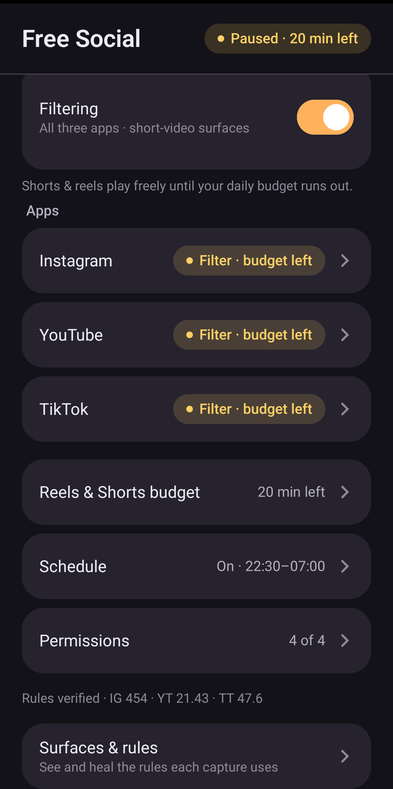
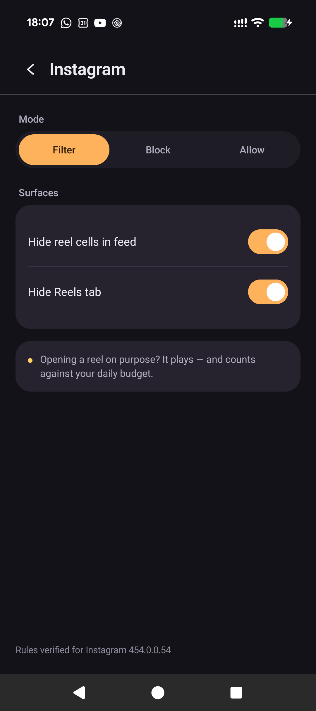
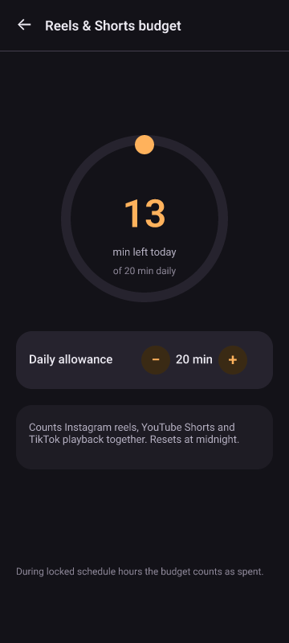
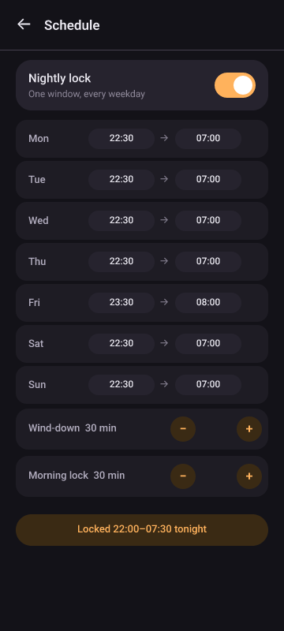
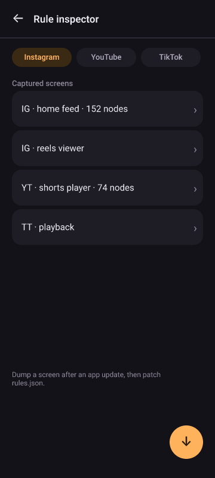

<p align="center">
  
</p>

<h1 align="center">Free Social</h1>

<p align="center"><strong>Scroll past. Watch on purpose.</strong></p>

<p align="center">
  An Android app that removes reels and shorts from inside Instagram, YouTube and TikTok —
  while the apps themselves stay fully usable.
</p>

<p align="center">
  <a href="https://github.com/K3vinb5/free-social/actions/workflows/release.yml"></a>
  <a href="https://github.com/K3vinb5/free-social/releases"></a>
  
  
</p>

---

## What it is

Free Social is not a replacement client, a VPN, a DNS filter or a webview. It is an
[AccessibilityService](https://developer.android.com/guide/topics/ui/accessibility/service)
that reads the **real** Instagram, YouTube and TikTok node trees and neutralises the
short-video surfaces inside them: reel cells in the feed, the Reels tab, the Shorts shelf,
the Shorts player, TikTok playback.

Everything else in those apps keeps working — DMs, search, stories, comments, profiles,
long-form video. Whole-app blocking exists too, but it is opt-in per app, never a default.

The app has **no `INTERNET` permission**, no accounts and no telemetry. It cannot phone
home, because it was never given the ability to.

## Features

| Feature | What it does |
| --- | --- |
| Reels & Shorts filter | Hides short-video surfaces inside Instagram, YouTube and TikTok. Passive feed scrolling is never touched. |
| Per-app Filter / Block / Allow | Three states per app. Settings propagate to the running service immediately. |
| DIRECT-ENGAGEMENT policy | The budget clock runs only when *you* open Reels, Shorts or TikTok playback — not while you scroll a normal feed. |
| Reels & Shorts budget | One shared daily allowance across all three apps, reset at midnight. Spent allowance follows the live clock during locked hours. |
| Nightly sleep window | Per-weekday bedtime and wake time, enforced with exact alarms. Always on, and never shorter than 6 hours. |
| Escape flash | A 2.2 s explanation after a blocked surface, never a dismissable wall. |
| Rule inspector | Dump the screen you are looking at, see every matching rule and its anchor evidence. |
| Guided node capture | Launches the target app, waits until the surface is actually detected, records for ~15 s, auto-stops. |
| Editable rule override | Export, edit and re-import `rules.json` to heal a broken rule **without a new build**; revert with *Use built-in rules*, with an override-age warning. |
| Staleness warning | Compares each rule's verified app version with the installed one and warns before a vendor update silently degrades filtering. |
| Dump auto-prune | Keeps capture dumps bounded instead of growing forever. |
| Offline by construction | No network permission, no analytics, no account, no backend. |

<p align="center">
  
  
  
  
</p>

## How it works

1. **Install and grant.** Sideload the APK and enable the *Content filtering* accessibility
   service. The optional *Whole-app blocking* service, the overlay and the battery exemption
   are separate, opt-in grants — the Permissions screen shows live status for each.
2. **Allow restricted settings on Android 13+.** Because the APK is sideloaded, Android hides
   the accessibility toggle behind *App info → ⋮ → Allow restricted settings*. Without this
   step the service switch is dead. The setup wizard walks through it.
3. **Pick a mode per app.** Filter is the default for all three. The service then watches only
   the foreground app's windows and acts on the surfaces you chose.

## Quick start

1. Download `free-social-<version>-<sha>.apk` from
   [Releases](https://github.com/K3vinb5/free-social/releases) (or
   [freesocial.k3vinb5.dev](https://freesocial.k3vinb5.dev)). Stable builds are direct
   `.apk` files, and nightlies join the same list once the nightly workflow publishes one.
   `free-social-<version>-<sha>.zip` holds the same signed APK plus a `README.txt` with these
   install steps, if you want them next to the file.
2. Tap the APK. Allow install from this source when prompted.
3. Follow the setup wizard: restricted settings → filtering service → optional block service
   and battery exemption → done. Rules are verified for the Instagram, YouTube and TikTok
   versions listed on the hub; an app update raises a staleness warning instead of failing
   silently.

## How the engine works

The service receives accessibility events, rebuilds a bounded snapshot of the relevant
window's node tree, and asks a small ordered rule catalog whether any **anchor** matches.
Anchors are view IDs, structural relationships, classes and `selected` state — **not UI
strings** — so rules survive a German or Japanese phone. Loader tests enforce the
language-independence rule; a text-anchored rule that cannot be proven locale-proof does not
ship.

Matching is gated by policy, not by a blunt "is this app open" check:

- **DIRECT-ENGAGEMENT** — a passive feed scroll is not engagement. Only a deliberate entry
  into a short-video surface starts the budget clock.
- **One action per scan** — the most escape-like action wins: home tab, back, scroll past,
  click a view, redirect home. Layer 1 neutralises; layer 2 only runs when the budget is
  exhausted or the nightly window is locked.
- **Budget** — shared daily minutes, midnight reset, locked hours counted as spent.
- **Fail-open, but loudly** — if a vendor update changes the tree, rules stop matching. The
  app does not pretend otherwise: it warns on version staleness, and the inspector shows
  what no longer matches.

### Why anchors, not text

Localised builds change every visible string but rarely change resource IDs or the shape of
the view hierarchy. A rule such as "the Reels tab is the `clips_tab` whose `selected` state
flipped" keeps working in any language; a rule that looks for the word "Reels" does not.
Text is used only where a vendor exposes nothing else (YouTube's Shorts shelf has no view
IDs at all), and those rules are pinned by tests with captured trees from multiple locales.

### What "fail-open" means here

The app never blocks a whole target app because a rule broke. If nothing matches, the app
behaves as if filtering were off, warns about staleness, and lets you repair the rule. That
trade-off is deliberate: over-blocking a messaging app is worse than a reel leaking through.

Spec: [`docs/SPEC.md`](docs/SPEC.md). Rule provenance and the defect log:
[`docs/rules/RULES.md`](docs/rules/RULES.md).

## Architecture

```
app/src/main/java/dev/k3vinb5/freesocial/
├── core/       rule model + loader, budget, schedule state, version staleness
├── filter/     accessibility engine: node tree, anchors, gate, capture, dumps
├── block/      whole-app block + exact-alarm schedule boundaries
├── ui/         Compose screens, block screen, escape flash
└── settings/   settings repository (SharedPreferences)

app/src/main/assets/rules.json    built-in, versioned rule catalog
app/src/test/                     258 JVM tests, no device required
tools/device/                     semantic on-device scenario driver (adb, no x/y)
docs/rules/                       root-cause defect log and re-verification record
```

The filter engine and the block engine are two separate accessibility services so that
granting one never implies the other. All UI is Jetpack Compose + Material 3; the app has one
runtime dependency beyond AndroidX: kotlinx-serialization for the rule document.

## Testing and verification

Correctness here is not "it compiled".

- **258 JVM tests** cover the rule loader's locale-proof enforcement, the negotiation gate,
  the DIRECT-ENGAGEMENT decision table, budget rollover, schedule windows, dump pruning,
  rule overrides and staleness comparison. No emulator needed: `./gradlew test`.
- **A real-device scenario driver** ([`tools/device/drive.py`](tools/device/drive.py)) runs
  Playwright-style scenarios against the actual apps. Selectors are semantic (view ID, text,
  content description, class); every action resolves bounds from a fresh `uiautomator dump`,
  so scenarios contain no coordinates. It saves numbered screenshots, every dump, logcat
  excerpts and a pass/fail summary under `reverse/runtime-*/`. There are currently 11
  scenarios, including passive-feed-untouched, direct-entry-pays and DM carve-out.
- **A written defect log** in [`docs/rules/`](docs/rules/) records root causes, not just
  symptoms, plus the re-verification protocol in
  [`REVERIFY.md`](docs/rules/REVERIFY.md). Rules were authored from fresh live-device dumps
  on a Pixel 9a and re-verified on an Android 13 ColorOS device.

When a rule is fixed, it lands with a test that fails without the fix and a device scenario
that proves the behaviour in the app the rule is about.

## Building from source

Requirements: **JDK 21**, Android SDK platform 36 and build-tools 36.0.0 (the Gradle wrapper
is 8.14.3, AGP 8.13.2). `local.properties` must point at your SDK.

```bash
./gradlew test            # 258 JVM tests
./gradlew assembleDebug   # debug: app/build/outputs/apk/debug/app-debug.apk
./gradlew assembleRelease # signed release: app/build/outputs/apk/release/app-release.apk (needs keystore.properties)
```

Release packaging lives in `tools/release/` and is driven by the
[`Release`](.github/workflows/release.yml) and reusable
[`build-release`](.github/workflows/build-release.yml) workflows.

The public download list is generated, never hand-edited:
`tools/release/publish_downloads.sh <release|nightly> <version> <sha> <artifact-dir>` copies the
built APK and zip into `website/downloads/` and records them in `website/downloads/versions.json`
(newest 10 per channel; pruned nightly files are deleted). The site's Stable/Nightlies tables
render from that file at build time. Re-running it with the same arguments is a no-op.

The same pipeline ships the site itself: `website-image.yml` builds `website/` into
`ghcr.io/k3vinb5/free-social-website:<sha>`, and `build-release.yml` then runs
`tools/release/deploy-site.sh` to pull that image on the docker host through Portainer —
health-gated, with automatic rollback to `<container>-prev`.

## Honest limitations

- **Fail-open by design.** Android apps are not a stable API. When Instagram, YouTube or
  TikTok rename a view or restructure a screen, the affected rule stops matching and the
  surface can come back. The app warns (installed version newer than the rule's verified
  stamp) but it cannot prevent it. The override flow exists precisely for this: capture the
  new tree, patch the rule, keep the fix until the next release.
- **Accessibility is a fragile host.** Aggressive OEM battery managers (ColorOS, MIUI and
  friends) kill background services. The app offers the battery exemption and reports service
  health, but it cannot win against a vendor that ignores Android's rules.
- **Sideload only.** Not on Google Play. Android 13+ additionally hides the accessibility
  toggle behind *Allow restricted settings* until granted per install.
- **Three apps, one job.** v1 covers Instagram, YouTube and TikTok. Snapchat, X and Facebook
  were analysed and deliberately deferred.
- **Known rough edge.** The TikTok DM carve-out is structurally matched; its live check is
  still pending.
- **No cloud, no sync, no family accounts.** Settings live on the device, and nothing leaves
  it.

## License

[MIT](LICENSE) © 2026 Kevin Borges.

## Why

Short video is engineered to be hard to leave. The feed is not the problem — the infinite
reel inside it is. Free Social takes that one surface away and gives you back the app you
actually opened: the messages, the search, the people, the long videos. It asks for no
account, sends nothing anywhere, and does not pretend discipline is a subscription.

Small app. One wish: that you close it and go do the thing you meant to do.
